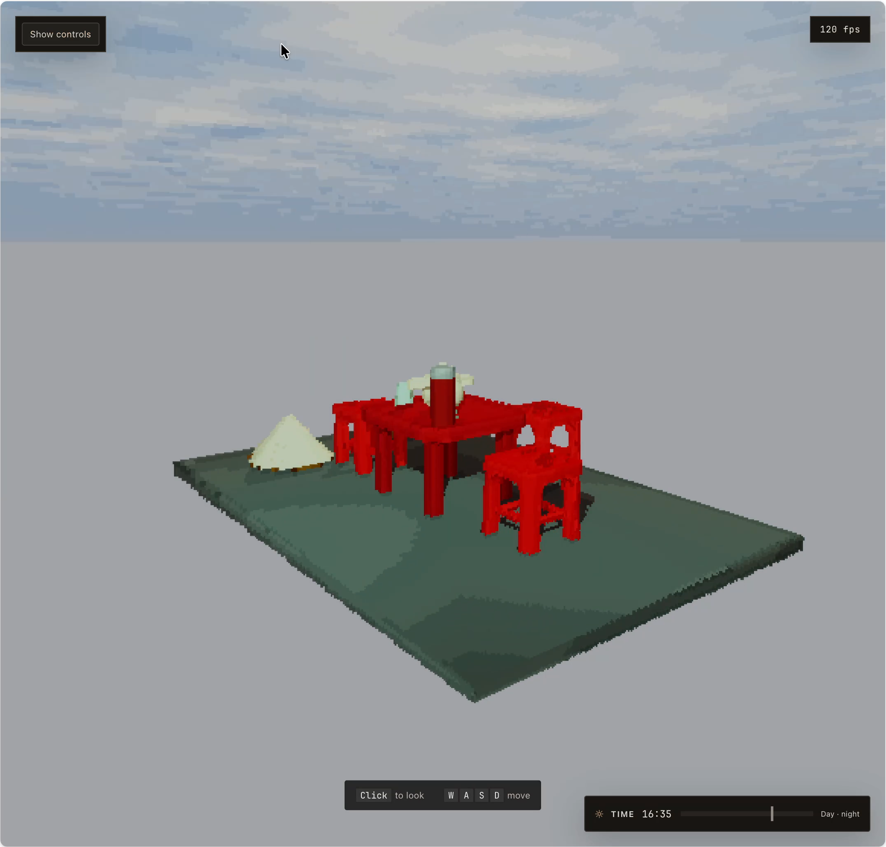

# 3D Pixel Art — Texel Splatting code



*Showcase image of the production tea-stall assets; these assets are not bundled with this code-only repository. The image is included for display only and is not covered by the repository's MIT license.*

This is a **code-only** open-source release of the Texel Splatting renderer and its Vietnamese tea-stall demo integration. It includes renderer/source code, a GLB loader, tests, and a small synthetic fixture generator.

**Production models and assets are not included.** The production GLBs, TopoTopo graphs and other procedural definitions, reference images, previews, other screenshots and videos, asset provenance/reports, and private/local project data are intentionally excluded. The README hero above is the one explicitly authorized showcase image; it depicts production assets that are not bundled, and is included for display only—not under the repository's MIT license. The demo therefore runs its clearly labeled **synthetic mock fixture**, not the production tea-stall scene. No production-asset or photo-fidelity claim is made.

The `web-demo/` code is derived from [Dylan Ebert's Texel Splatting](https://github.com/dylanebert/texel-splatting), upstream commit [394d350f](https://github.com/dylanebert/texel-splatting/commit/394d350f91842779ed4c45760bd4ea9a07ce5c4c). Its original MIT license and attribution are retained in [`web-demo/LICENSE`](web-demo/LICENSE). This project does not imply endorsement by the upstream author.

## Run locally

Requires Node.js and npm. From the repository root:

```sh
cd web-demo
npm ci
npm test
npm run check
npm run dev
```

Open the URL printed by Vite. Use `?scene=mock` to explicitly select the synthetic fixture, or `?baseline=1` for the original procedural baseline. The renderer requires a browser with WebGPU support; browser/device compatibility is not guaranteed.

To build the static demo:

```sh
npm run build
```

The build script checks for optional sibling production exports, but none are part of this repository. Without them, production scenes remain unavailable and the mock fixture is still available. See [`web-demo/README-TEA-STALL.md`](web-demo/README-TEA-STALL.md) for implementation and test details.

## Project prompts and workflow

An English-language synthesis of the original requests, reusable prompt templates, parallel workflow, corrections, evidence, and limitations is available in [`docs/PROMPTS_AND_WORKFLOW.md`](docs/PROMPTS_AND_WORKFLOW.md). It is a sanitized summary, not a transcript; it does not include private session data or assets excluded from this code-only release.

## License scope

The root [`LICENSE`](LICENSE) applies to code and associated documentation in this repository only. It does **not** license third-party code beyond its own notices, or any excluded/private assets, references, models, graphs, or generated media. The showcase image above is excluded from the MIT grant and included for display only. See the retained upstream notice at [`web-demo/LICENSE`](web-demo/LICENSE).
